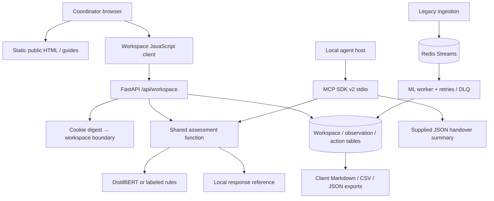

# SafetyOps Copilot — Project Handoff & Portfolio Kit

Updated: 2026-11-09. Owner: Brejesh. Repository:
https://github.com/brej-29/safetyops-copilot

This is the project continuity document: product intent, implementation,
engineering problems, evidence, deployment boundaries, and reusable portfolio
material. Deployment acceptance results are recorded at the end after verification.

## The project in one sentence

SafetyOps Copilot turns a safety observation into an explainable assessment,
a corrective action with an owner and due date, and a shift handover that preserves
what happened and what remains unfinished.

## Why the project exists

The original project demonstrated an applied ML/MLOps pipeline: ingest text and
images, enrich them, persist results, and generate triage briefs. The upgrade's
product goal is stronger: give individual safety coordinators a reason to return
on the next shift. A severity prediction alone does not establish ownership,
completion or continuity. The new workflow closes that gap with tracked actions,
closure evidence and portable handovers.

The user confirmed individual safety coordinators as the primary audience and
delegated the interface and implementation direction. This release remains an
individual tool, not a shared enterprise EHS platform.

## What is implemented

| Capability | Implementation and boundary |
| --- | --- |
| Public website | Crawlable HTML homepage, practical guides, privacy, responsive layout |
| Motion | Authored signal-path geometry, slow orbit, modest scroll response; reduced-motion handling |
| Personal workspace | Opaque browser credential, hashed server-side, HttpOnly cookie; SQL persistence |
| Observation register | Text/location capture, severity filter, search, assessment detail |
| Assessment | Existing DistilBERT when available; explicit rule fallback; lexical severity floor; recurrence arithmetic |
| Corrective actions | Owner, due date, open/in-progress/closed state; evidence required to close |
| State history | Timestamped changes and closure notes, revision checks against stale tab edits |
| Shift handover | Markdown report, spreadsheet-friendly action CSV, schema-versioned JSON archive |
| Synthetic demo | Separate in-memory sample; cannot silently overwrite private records |
| MCP | Optional local official-SDK v2 stdio server with three read-only tools |
| Discoverability | Titles/descriptions, canonicals, OG image, JSON-LD, sitemap, robots, llms.txt, useful guide content |
| Project presentation | Screenshot gallery, actual browser-recorded GIF/WebM, README diagrams, design documentation |
| Quality | Python regression suite, browser workflow tests, keyboard focus checks, desktop/mobile captures |

## What remains from the original platform

- FastAPI ingestion and querying APIs.
- Redis Streams abstraction and consumer-group worker.
- Raw/enriched events and daily/hourly aggregate tables.
- DistilBERT training/evaluation with MLflow tracking.
- YOLO hard-hat inference, with documented model/stub behavior.
- LangGraph triage: retrieve context, assess risk, load a runbook, write a brief,
  optionally enhance it using an OpenAI-compatible LLM endpoint.
- Retry/DLQ handling, worker metrics, Prometheus/Grafana and drift reporting.
- Streamlit console as a separate legacy client.

The new workspace is intentionally independent of Redis so its user workflow can
continue when optional streaming infrastructure is unavailable.

## Architecture and code map

| File / directory | Responsibility |
| --- | --- |
| `apps/web/` | Public/app HTML, shared stylesheet, scripts, self-hosted font, social image |
| `apps/web/routes.py` | Static routes, assets, sitemap, robots, llms and page headers |
| `scripts/build_web.py` | Source generator for the five tracked HTML pages |
| `apps/api/workspace.py` | Session creation, private reads, observation/action mutations, deletion |
| `safetyops/db/workspace.py` | Additive workspace, observation and corrective-action models |
| `safetyops/domain/assessment.py` | Shared assessment policy, rationale and versioned score |
| `safetyops/domain/predictions.py` | Inference provenance added to text predictions |
| `safetyops/ml/nlp/infer.py` | Existing model inference; early missing-config fallback avoids heavy imports |
| `services/mcp/server.py` | Local agent tools using the shared assessment/runbooks |
| `tests/test_workspace.py` | Isolation, validation, recurrence, closure, conflict, origin/rate limits, crawl boundaries |
| `tests/test_mcp.py` | Real MCP discovery and structured tool calls |
| `tests/web/workspace.spec.cjs` | Browser workflow, reload persistence, exports, keyboard, XSS text, deletion, responsive checks |
| `scripts/capture_media.cjs` | Reproducible product screenshots and browser tour |
| `docs/media/` | Synthetic-data product captures and provenance |
| `DESIGN.md`, `.impeccable/design.json` | Actual visual tokens and reusable component documentation |

## Important engineering decisions

**Same-origin website.** Serving the client and API together avoids a separate
CORS configuration and client-side deployment secrets. Public pages stay readable
without a JavaScript application shell.

**Capability-based personal storage.** A 256-bit random browser credential is
stored in an HttpOnly cookie; the database stores only a SHA-256 digest. Every
observation/action lookup is scoped to its workspace. This is access isolation,
not named-user authentication, account recovery or team authorization.

**Transparent scoring.** Severity contributes 25/55/85 points. Prior observations
in the same category within seven days add three points each, up to 15. The record
stores a breakdown and rule version. The score is a heuristic, not probability.
The historical LangGraph endpoint retains its separate earlier score policy;
do not imply scores from the two interfaces are directly interchangeable.

**Human review.** Category matching is lexical. Serious-harm terms can impose a
severity floor, which can misread negation. All results remain draft decision
support. The UI does not label model confidence as a calibrated safety guarantee.

**Evidence before closure.** A closed action needs a note of at least eight
characters. That records the user's evidence statement; it does not validate work
on site. Conditional revision updates reject stale writes with HTTP 409.

**Read-only MCP boundary.** The server consumes text or an explicitly supplied
archive; it does not retrieve browser records, read arbitrary filesystem paths,
call external LLMs or write actions. A remote authenticated team MCP endpoint
would need a separate identity and authorization design.

**Light web runtime.** Semantic HTML/CSS/JavaScript keeps public content crawlable,
keeps production independent of Node tooling and avoids a framework migration
without a product reason. Playwright is a development dependency only.

## Problems encountered and how they were handled

1. **A demo pipeline lacked a recurring job.** Added the observation → ownership →
   closure → handover loop instead of stopping at presentation changes.
2. **The old Redis endpoint was unavailable.** Verified production Postgres was
   healthy while Redis/heartbeat were not. Isolated the new workspace from the
   stream. Restoring the external stream is a separate operational task.
3. **Missing model artifacts triggered expensive imports.** Check for model
   config before importing Transformers/Torch. Fallback records identify rules.
4. **The first browser save timed out during old lazy model initialization.**
   Diagnosed the server path rather than hiding the timeout; the early fallback
   check removes that cost when artifacts are absent.
5. **A demo URL survived workspace creation.** Clear the sample hash after loading
   the real workspace so reloads return to saved records. Browser regression covers it.
6. **A font download selected a static heavy weight.** Replaced it with the
   variable Manrope range and verified typography in real screenshots.
7. **Mobile spacing and work ordering needed correction.** Fixed inherited
   container padding and put capture/register/detail in a useful mobile sequence.
8. **Keyboard selection destroyed its focused DOM button.** Restore selection
   focus on desktop and move focus to mobile detail; Enter → Tab is tested.
9. **Scripted scrolling bypassed reduced-motion intent.** Every scripted scroll
   now checks the preference, alongside CSS animation overrides.
10. **MCP SDK output contracts were stricter than an untyped dictionary.** Used
    typed dictionary outputs with explicit structured output and verified real
    protocol discovery/calls against SDK v2.
11. **Screenshot automation initially captured a sticky header mid-document.**
    Reset scroll to the document top before full-page capture; validate captures.
12. **The Windows sandbox could not start processes (error 1909).** Used the
    approved direct shell; in-app browser automation was unavailable, so local
    Playwright supplied real rendering and interaction evidence.
13. **An approval-review usage limit temporarily interrupted execution.** The
    rejected command did not run; after the user instructed continuation, retry
    through the same review path succeeded. No approval check was bypassed.

14. **HTTPS terminated at the Cloud Run proxy.** Live acceptance caught a missing
    Secure cookie attribute because the application saw an internal HTTP request.
    Cloud deployment mode now forces Secure, with a regression test and live check
    before traffic promotion.

15. **Cold trained-model loading blocked the first live save.** Model warm-up now
    runs in a background thread. The workspace never waits for model loading:
    it saves an identified rule assessment while warming, then uses the trained
    model for later observations once ready. Saved assessments remain immutable
    snapshots; they are not silently rescored. A regression prohibits synchronous
    model loading on this path.

## Evidence you can cite

The model card describes a roughly 273k-narrative source corpus, a balanced
9,105-row training pool and a separate **1,605-row held-out test set**. Do not say
that the model was trained on all 273k reports.

| Existing historical test result | Rule baseline | DistilBERT |
| --- | ---: | ---: |
| Accuracy | 0.3988 | 0.7807 |
| Macro-F1 | 0.3357 | 0.7799 |
| High-severity recall | 0.1607 | 0.8766 |

These results predate the website upgrade. No new model training or prospective
safety-outcome study was performed in this release. Mining-domain transfer is
unvalidated. Source: `models/nlp/eval_results.json` and the model card.

Engineering evidence at completion: 47 Python tests pass with optional MCP
installed, repository Ruff checks pass, and desktop/mobile browser workflow tests
pass. The design finish reviewer issued **ship** after two accessibility fixes.
The detector's flat-type warnings came from its inability to resolve the runtime
`/assets/styles.css` URL to the source file; actual CSS and screenshots show the
separate type scale. See deployment acceptance for final live checks.

## Honest limitations and next work

- No shared accounts, SSO/RBAC, email recovery or cross-device workspace transfer.
- Cookie loss loses access; expiry does not erase database records.
- JSON is an archive export; import/restore is not implemented.
- No automatic reminders, push/email notifications or background safety monitoring.
- No evidence attachments or independent real-world verification.
- No distributed quota, formal uptime guarantee or tested disaster recovery.
- Automatic retention cleanup and database-provider backup policy need owner review.
- Workspace mutations are capped at 40/minute per direct network peer in process;
  workspaces cap at 500 observations and 1,000 actions.
- Restore the external Redis service before presenting live streaming as healthy.
- Search rankings, indexing and AI recommendations cannot be guaranteed.
- No measured customer adoption, retention, incident reduction or time savings yet.

Most useful next steps: observe coordinators using the workflow; validate whether
recurrence scoring helps; add recoverable identity and migration tooling; test
calibration/domain transfer; restore streaming infrastructure; add reminders only
when there is a reliable ownership/notification model.

## Portfolio case study draft

**Title:** From an ML demo to a recurring safety operations workflow

**Problem:** An incident classifier can demonstrate model inference while leaving
real follow-up disconnected. Safety coordinators need to know who owns the next
action and what the incoming shift should review.

**Approach:** I extended an existing FastAPI/Redis/Postgres ML platform with a
same-origin web workspace. Observations retain the inference source and explicit
priority arithmetic. Corrective actions include owners, dates, closure evidence
and revision-checked history. A practical handover exports as Markdown, CSV or
JSON. A local MCP server exposes the same assessment logic to agents without
exposing browser credentials or granting write access.

**Validation:** Historical MSHA evaluation compares DistilBERT with a rule baseline
on 1,605 held-out narratives. The release adds isolation and action-workflow
regressions plus real desktop/mobile browser tests. It is deployed on the existing
Cloud Run infrastructure with production SQL storage.

**What I learned:** The difficult boundary was not another model feature. It was
making uncertainty visible and connecting predictions to work that people can
own, verify and carry into the next shift.

Adapt the voice to reflect the work you personally understand and can explain.
Do not imply every component was independently hand-coded without assistance.

## Resume / portfolio bullets

- Extended a FastAPI/Postgres safety platform into a persistent personal workspace
  for observation triage, corrective-action ownership and exportable shift handovers.
- Added inference provenance, versioned score explanations and recurrence context,
  with human-review boundaries and explicitly labeled model fallbacks.
- Implemented browser credential isolation, origin checks, evidence-gated closure
  and optimistic revision checks, validated by API and browser integration tests.
- Exposed shared assessment and runbook logic through an optional read-only MCP
  server, tested with the official SDK's real client.

## LinkedIn draft 1 — Product engineering

I revisited my SafetyOps Copilot project with a different question: what gives
someone a reason to return tomorrow?

The original pipeline classified incident text and PPE images. The new workflow
connects an observation to a reviewable assessment, an action owner, a due date
and closure evidence. At the end of a shift, the coordinator can export a usable
handover instead of starting from a dashboard screenshot.

I kept the ML limits visible and tested the complete browser workflow, including
persistence, exports and keyboard navigation. The interesting improvement was
connecting a prediction to follow-through.

Try it: https://safetyops-api-a5afr3rcdq-as.a.run.app/
Source: https://github.com/brej-29/safetyops-copilot

#Python #FastAPI #ProductEngineering #MLOps #WorkplaceSafety

## LinkedIn draft 2 — Applied ML evidence

A strong model metric still needs a clear boundary.

SafetyOps Copilot's checked-in MSHA evaluation compares DistilBERT with a rule
baseline on 1,605 held-out mining accident narratives: macro-F1 0.7799 versus
0.3357. That is historical outcome classification, not proof of future accident
prediction or transfer to every industry.

In the new workspace, each assessment identifies its inference path and shows the
priority arithmetic. Missing artifacts produce a labeled fallback. People review
the observation and decide what action belongs to the site context.

The goal is useful decision support with an explanation that survives the demo.

Model card and code: https://github.com/brej-29/safetyops-copilot

#AppliedML #ExplainableAI #NLP #ResponsibleAI #MLOps

## LinkedIn draft 3 — Agent integration

I added MCP to SafetyOps Copilot where it serves a specific job.

The local server offers three read-only tools: assess an observation, retrieve a
response runbook, and summarize a supplied handover archive. It shares assessment
logic with the web product, without reaching into browser cookies or allowing an
agent to silently close a corrective action.

I tested discovery and structured tool calls using the official Python SDK client.
The useful design choice was the capability boundary, not the protocol badge.

Setup: https://github.com/brej-29/safetyops-copilot/blob/main/docs/MCP.md

#MCP #AIAgents #Python #SoftwareArchitecture

## Suggested demo recording (90 seconds)

1. Show the public page and explain the individual coordinator's job.
2. Open the labeled sample, then create a blank personal workspace.
3. Record a de-identified observation and inspect its rationale/source.
4. Add an action with an owner and date; reload to demonstrate persistence.
5. Start and close the action with a concrete verification note.
6. Export the handover; show where model evidence and limitations are documented.
7. Optional: show MCP discovery and one read-only call.

Use synthetic data for all public recordings. Existing assets in `docs/media/`
are ready for a portfolio or post, with their provenance recorded alongside.

## Running, maintaining and promoting the project

- Start with `README.md` for commands and `docs/DEPLOYMENT.md` for rollout/rollback.
- `docs/MCP.md` contains the local agent contract and setup.
- `docs/SEO.md` lists implemented discoverability work and Search Console follow-up.
- `PRODUCT.md`, `DESIGN.md` and the workspace brief preserve intent and design.
- `context/03_DECISIONS_LOG.md` records architectural choices.
- Keep credentials out of commits, screenshots and issue reports.
- Re-run the static page generator after changing its source content.
- Update this handoff after meaningful releases, with actual validation evidence.

## Final deployment acceptance — 2026-11-09

- Live URL: https://safetyops-api-a5afr3rcdq-as.a.run.app/
- Verified revision: `safetyops-api-00008-feq`, serving **100%** of main traffic.
- Rollback revision retained: `safetyops-api-00005-xxx`.
- Image: `asia-southeast1-docker.pkg.dev/safetyops-copilot/cloud-run-source-deploy/safetyops-api:workspace-v02-warm`.
- Tagged acceptance URL: https://workspace-review---safetyops-api-a5afr3rcdq-as.a.run.app
- Main homepage, workspace, both guides, privacy, robots, sitemap, llms and social
  image returned HTTP 200 after promotion. Unauthorized workspace reads returned 401.
- Complete live Playwright workflow passed: desktop/mobile, isolated cookie access,
  observation persistence across reload, action creation/progress/closure, actual
  Markdown line breaks and CSV BOM/rows, downloads, search, text-injection handling,
  keyboard Enter→Tab selection, deletion, no horizontal overflow or JavaScript errors.
- Production workspace cookie verified Secure, HttpOnly, SameSite=Strict; private
  responses verified no-store. Identified disposable failed-test records were removed.
- One post-warmup live DistilBERT save took **0.33 seconds** in a disposable API
  check. This single observation is not a benchmark, load test or latency guarantee.
- Final local suite: **47 passed**; Ruff checks passed. Existing Evidently/SciPy
  deprecation and small-fixture numerical warnings remain non-failing.
- Design reviewer: **ship**, after keyboard and reduced-motion corrections.
- GitHub homepage, description and 20 relevant topics were updated and verified.
- Public release source is on the repository's main branch; GitHub Actions runs
  Python/MCP and browser jobs on pushes. See the repository Actions tab for runs.
- Search Console ownership/submission remains an owner follow-up. Indexing,
  search rankings and AI recommendations are not guaranteed.
- Legacy Redis/worker connectivity remains an explicitly documented external
  infrastructure issue; it does not block the deployed SQL-backed workspace.
- Remote release CI also passed both jobs (`ci` for Python/MCP and `web` for the
  full browser workflow) for source commit `21d998b2a2fadaaa90189811d967b4d76f93eda1`:
  https://github.com/brej-29/safetyops-copilot/actions/runs/42555287092
  The final follow-up commit records this evidence only; runtime source is unchanged.
