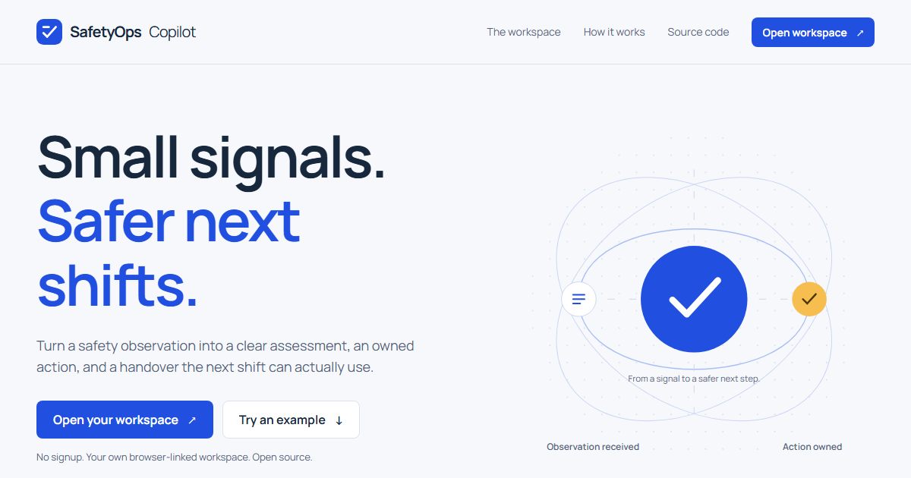
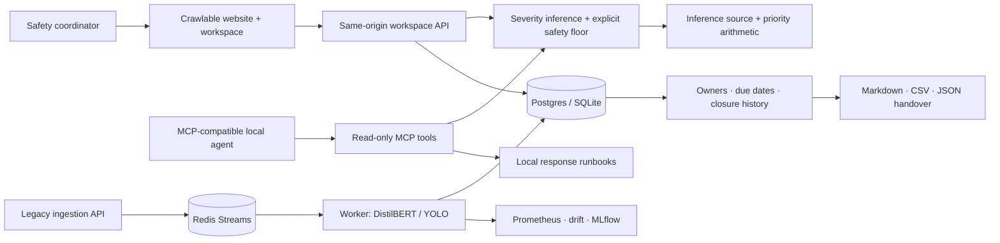
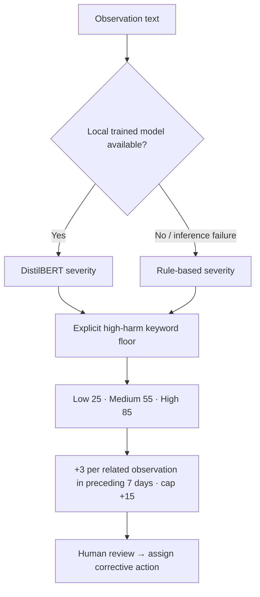

# SafetyOps Copilot

**Small signals. Safer next shifts.**

An open-source safety workspace that turns an observation into an explainable
assessment, an owned corrective action, and a useful shift handover. Built for
individual safety coordinators, backed by a real database.

[**Open the live website →**](https://safetyops-api-a5afr3rcdq-as.a.run.app/)
· [Try the sample workspace](https://safetyops-api-a5afr3rcdq-as.a.run.app/app#demo)
· [How assessment works](https://safetyops-api-a5afr3rcdq-as.a.run.app/guides/incident-triage)
· [Project handoff & portfolio kit](HANDOFF.md)




[Full-page capture](docs/media/homepage.png) ? [Desktop workspace](docs/media/workspace.png)
? [Mobile workspace](docs/media/workspace-mobile.png)

## A workflow worth returning to

A prediction is useful only when someone acts on it. SafetyOps keeps the next
step beside the original observation:

1. **Capture** what happened and where.
2. **Review** severity, inference source, score arithmetic and response references.
3. **Assign** a corrective action, owner and due date.
4. **Return** to open and overdue actions each shift.
5. **Close with evidence**, then export a Markdown handover, action CSV or JSON archive.


[Watch the WebM recording](docs/media/workspace-tour.webm). All media show explicitly
synthetic records; they are captures of the implemented product, not mockups.

The personal workspace is isolated from the public sample and legacy streaming
feed. Records persist in SQL storage. A random HttpOnly browser cookie is the
access key; only its SHA-256 digest is stored. Clearing cookies loses access.
There is no email login, recovery, team sharing or archive restore in this release.

## Inside the system



The primary website uses semantic HTML, CSS and a small vanilla JavaScript client,
served by FastAPI. Public pages are indexable without executing JavaScript.
Workspace records and controls are excluded from indexing. No Node build is
required in production.

The existing Streamlit console, LangGraph triage, ML training, PPE inference,
Redis consumer groups, retries/DLQ and monitoring remain in the repository.
**Operational distinction:** the old production Redis connection was unavailable
at this upgrade's infrastructure check. The new workspace uses SQL directly and
does not depend on it. See [deployment notes](docs/DEPLOYMENT.md).

## Explainable assessment

Optional model artifacts warm in the background. A first save can use the labeled
rule fallback while the model loads; subsequent observations use the ready model.
Saved assessments remain snapshots and are not silently rescored.

Each saved observation includes its source (`distilbert` or `rules`), category,
severity, rule version, rationale, runbook reference and the score breakdown.



Priority is a heuristic for ordering work, **not an accident probability**. Category
matching and the high-harm floor are lexical and can misunderstand context or
negation. A low score never establishes that a workplace is safe.

### Historical model evidence

These are the existing checked-in evaluation results, not a claim that this UI
upgrade retrained the model:

| MSHA held-out evaluation (1,605 narratives) | Accuracy | Macro-F1 | High-severity recall |
| --- | ---: | ---: | ---: |
| Rule baseline | 0.3988 | 0.3357 | 0.1607 |
| Fine-tuned DistilBERT | 0.7807 | 0.7799 | 0.8766 |

The source corpus contains approximately 273k usable narratives. The balanced
training pool contains **9,105 rows**, with a separate 1,605-row test set; the model
was not trained on all 273k records. Mining-domain transfer remains unvalidated.
[Model card](models/nlp/MODEL_CARD.md) · [Exact results](models/nlp/eval_results.json)
· [Vision model card](models/vision/MODEL_CARD.md)

## Run the website locally

Python 3.11 is recommended. Install the service/test dependencies; heavy ML
packages are optional.

```bash
python -m venv .venv
# Activate .venv for your shell, then:
pip install -r requirements-dev.txt
```

Set `SAFETYOPS_DATABASE_URL=sqlite:///./safetyops.db` in your local environment
(or `.env`; see [.env.example](.env.example)). Then run:

```bash
uvicorn apps.api.main:app --reload --host 127.0.0.1 --port 8000
```

Open [localhost:8000](http://localhost:8000). The personal workspace needs SQL
only. Redis startup errors are logged when the optional streaming infrastructure
is absent; they do not stop the website. For the full stack:

```bash
docker compose -f infra/docker-compose.local.yml up -d
python -m services.worker.run
# Optional legacy console, in another terminal:
streamlit run apps/ui/main.py
```

To use trained models, install `requirements/ml.txt`, then follow the model cards
and download scripts. Missing models remain explicitly labeled fallbacks.

## Use it from an agent

```bash
pip install -r requirements/mcp.txt
python -m services.mcp.server
```

The optional official-SDK MCP server runs locally over stdio. It exposes
`assess_incident`, `get_response_runbook`, and `summarize_handover`. Tools are
read-only, consume explicitly supplied data and cannot access browser credentials
or modify personal workspaces. [Setup and client configuration](docs/MCP.md).

## Validation and delivery

```bash
pytest -q                       # 47 tests with optional MCP dependencies installed
ruff check .                    # Repository CI checks
npm ci                          # Browser test tooling only
npx playwright install chromium
npm run test:web                 # Running website at http://127.0.0.1:8010
```

Set `SAFETYOPS_TEST_URL` to test another running instance. Browser tests cover
sample separation, persistence across reloads, action transitions and closure
evidence, exports, keyboard selection, text injection handling, deletion, desktop
and mobile overflow, and JavaScript errors.

[Deployment and rollback](docs/DEPLOYMENT.md) · [SEO and discoverability](docs/SEO.md)
· [Design system](DESIGN.md) · [Architecture decisions](context/03_DECISIONS_LOG.md)
· [Full project handoff](HANDOFF.md)

Use this as decision support alongside competent review and site procedures.
It is not an emergency monitor, compliance certification or replacement for an
official incident system. MIT licensed; font license is included separately.
